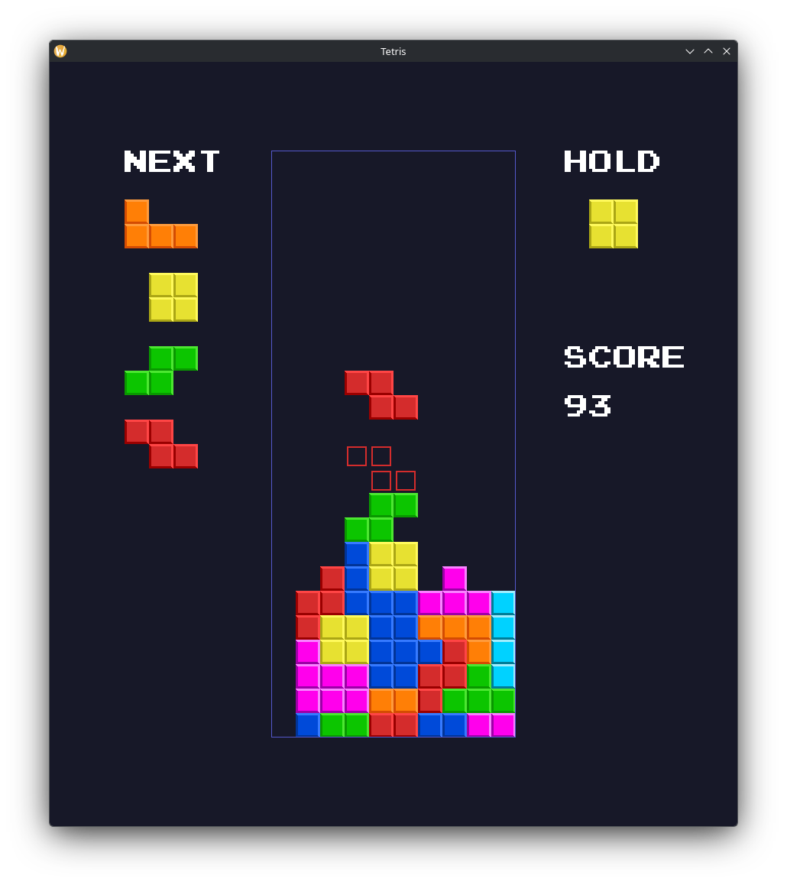

# Tetris

Tetris clone written in C++, using the SDL3 rendering library.



# Controls

- Step Left: A
- Step Right: D
- Soft Drop: S
- Hard Drop: W
- Clockwise Rotation: Right Arrow
- Counterclockwise Rotation: Left Arrow
- Hold Piece: Up Arrow

# Requirements

## Linux

- GCC
- CMake
- Ninja
- Development files for SDL3, SDL3 image, and SDL3 ttf

# Build Instructions

## Linux

Build the project in `Release` mode to try it out:

```bash
cmake -B build -S . -DCMAKE_BUILD_TYPE=Release -G Ninja
```

Build the project in `Debug` mode for testing/development:

```bash
cmake -B build -S . -DCMAKE_EXPORT_COMPILE_COMMANDS=YES -DCMAKE_BUILD_TYPE=Debug -G Ninja
```

You can then (re)build the project using:

```bash
cmake --build build
```

The program binary will be generated under `build/Release/` or `build/Debug/`,
depending on the build type.

# License

MIT
